# Getting started with Brick Worlds Engine

Brick Worlds Engine is a LEGO-style game engine that runs in your browser. You build maps from bricks and ready-made assets, join them into a world, dress characters, write game rules as nodes or code, design screens, direct cutscenes, mix the sound, and press Play — all in one editor. It grew out of LEGO World v68, which is still in this repository unchanged.

This guide shows how to launch the editor and walks through every part of it with screenshots. Inside the editor, **F1** opens the same material as a searchable Help guide, and the Start hub has two hands-on courses.

- [1. Launch the editor](#1-launch-the-editor)
- [2. The Start hub](#2-the-start-hub)
- [3. Learn by doing: tour, coding course, build viewer, Help](#3-learn-by-doing)
- [4. The editor at a glance](#4-the-editor-at-a-glance)
- [5. Build a map](#5-build-a-map)
- [6. Connect maps in the World graph](#6-connect-maps-in-the-world-graph)
- [7. Assets](#7-assets)
- [8. Characters](#8-characters)
- [9. Logic: graph and code](#9-logic-graph-and-code)
- [10. Screens and HUD](#10-screens-and-hud)
- [11. Cinematics](#11-cinematics)
- [12. Audio](#12-audio)
- [13. Play and debug](#13-play-and-debug)
- [14. The AI builder](#14-the-ai-builder)
- [15. Shortcuts, palette and phones](#15-shortcuts-command-palette-and-phones)
- [16. Saving and sharing](#16-saving-and-sharing)
- [17. If something goes wrong](#17-if-something-goes-wrong)

## 1. Launch the editor

You need **Node.js 20 or newer** (only to build it once) and a recent desktop browser with WebGL: Chrome, Edge, Firefox or Safari.

```sh
git clone https://github.com/garciaraul85/lego-world.git
cd lego-world
npm ci
npm run build
```

Then pick one way to open it:

| Way | How | Good for |
| --- | --- | --- |
| Straight from disk | Double-click `dist/editor.html` (or open it with your browser) | Playing and building; works offline |
| Local server | `npm run serve`, then open <http://localhost:8000/editor.html> | Working on the engine itself |
| Claude artifact | Open the published editor link | Using the AI builder with no API key |

`dist/editor.html` is one self-contained file: you can copy it anywhere. Your projects are saved inside the browser you open it in (see [Saving and sharing](#16-saving-and-sharing)).

Two URL flags help: `editor.html?hub` always opens the Start hub, `editor.html?nohub` never does. The original game is still `dist/index.html` (LEGO World v68).

## 2. The Start hub

The first time the editor opens you land in the **Start hub**. File › Start hub (Ctrl Alt H) brings it back at any time.

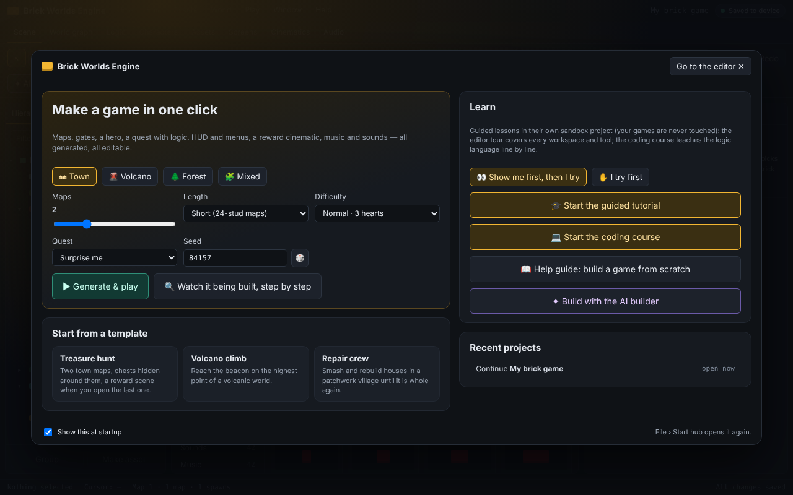

- **Make a game in one click** — pick a theme (Town, Volcano, Forest, Mixed), how many maps, the length, difficulty and quest, and a seed (the same seed always makes the same game). **Generate & play** builds it and starts playing; **Watch it being built, step by step** builds it one stage at a time so you can see how it is made (section 3).
- **Start from a template** — three ready games (Treasure hunt, Volcano climb, Repair crew) open in the editor.
- **Learn** — the guided tutorial (every workspace and tool), the coding course (the logic language), the Help guide and the AI builder. Choose **Show me first, then I try** to watch each step before doing it, or **I try first**.
- **Recent projects** — everything you made on this device.

Untick **Show this at startup** to go straight to the editor next time.

## 3. Learn by doing

### The guided tutorial (editor tour)

10 chapters walk through every workspace and tool in a sandbox project, so your own games are never touched. Each step spotlights a control, explains it, and waits until you have done it.

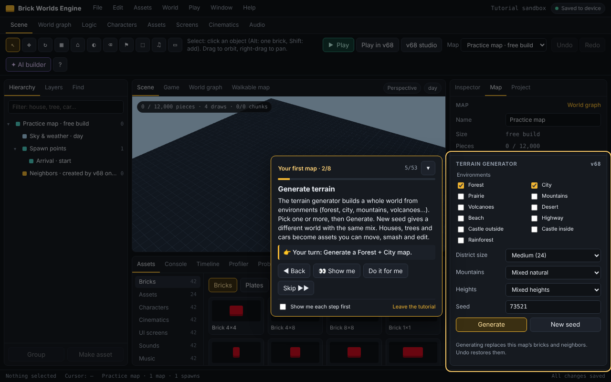

**Show me** plays the step with a demo pointer — the change really happens in the editor — and then puts everything back so you can repeat it yourself. **Do it for me**, **Back** and **Skip** always work, and the card remembers where you were.

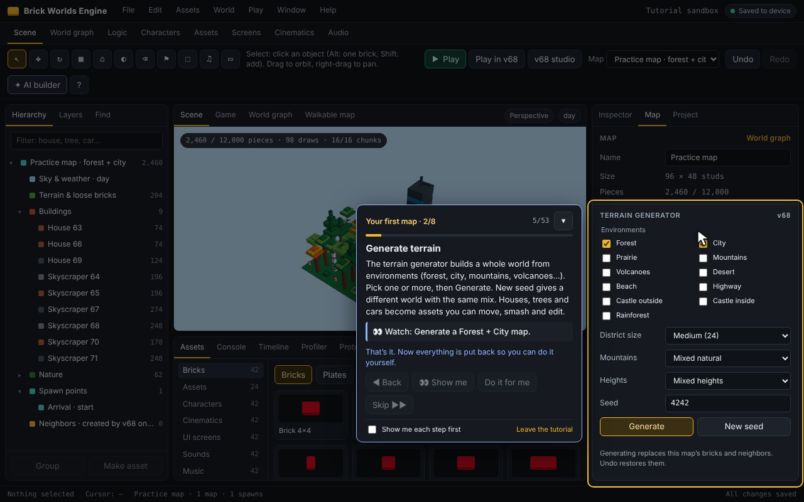

### The coding course

8 chapters and 37 lessons teach the logic language in the Code view: blocks and `log`, variables, every event, `if`/`else`, and/or/not, `wait`, `once`, random numbers, gates, world actions, sound, screen text, cutscenes, errors and breakpoints — ending with a whole small game written in code. The card shows exactly what to type.

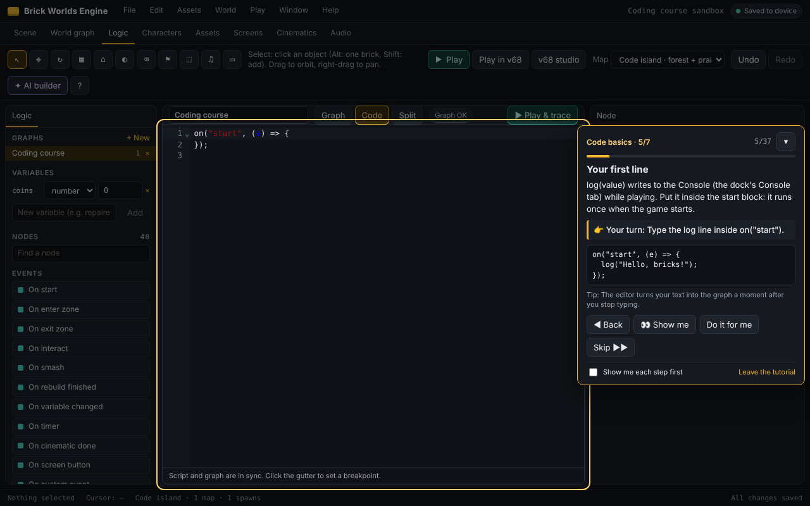

**Show me** types the code into the real editor so you watch it appear and turn into a graph; then it is removed again and it's your turn.

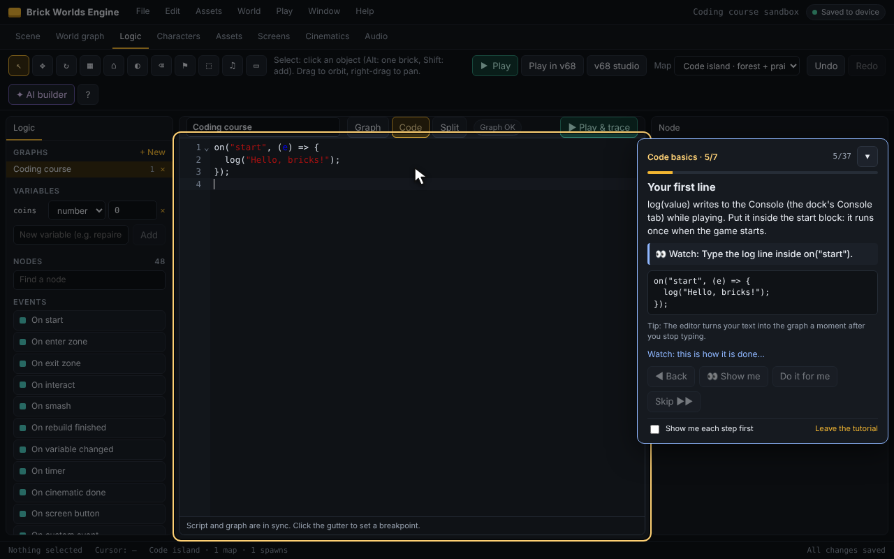

### Watch a game being built

From the Start hub, **Watch it being built, step by step** replays the game generator one stage at a time: name, terrain, maps, gates, hero, props, quest logic, HUD and menus, the reward cinematic, music, signs, and a final check. Each **Next** applies one stage (one undo step), opens the workspace it used, and tells you how to do the same by hand. **Back** undoes it, **Auto** plays the rest.

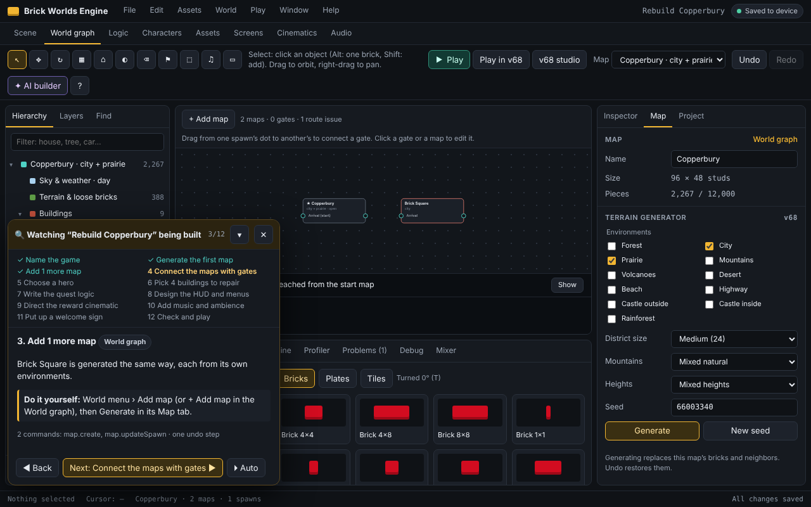

### The Help guide (F1)

A page per workspace, **Build a game from scratch** in 12 steps, the Coding guide, the AI builder, the logic reference (generated from the engine, so it is always current), every shortcut and limit, and troubleshooting. Links like *Open Logic ↗* jump straight to the workspace.

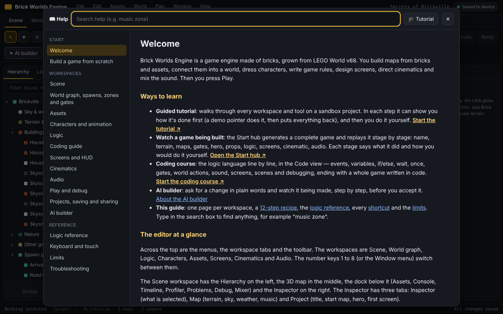

Search finds the right section as you type:

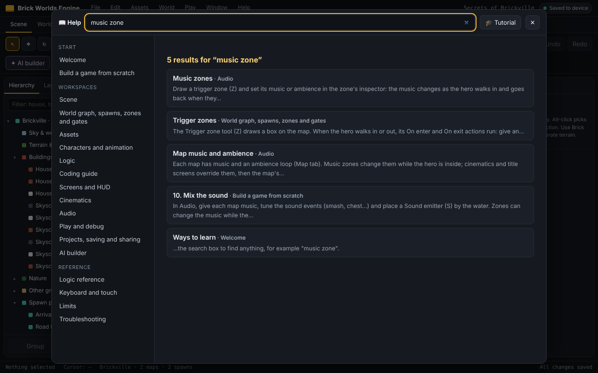

## 4. The editor at a glance

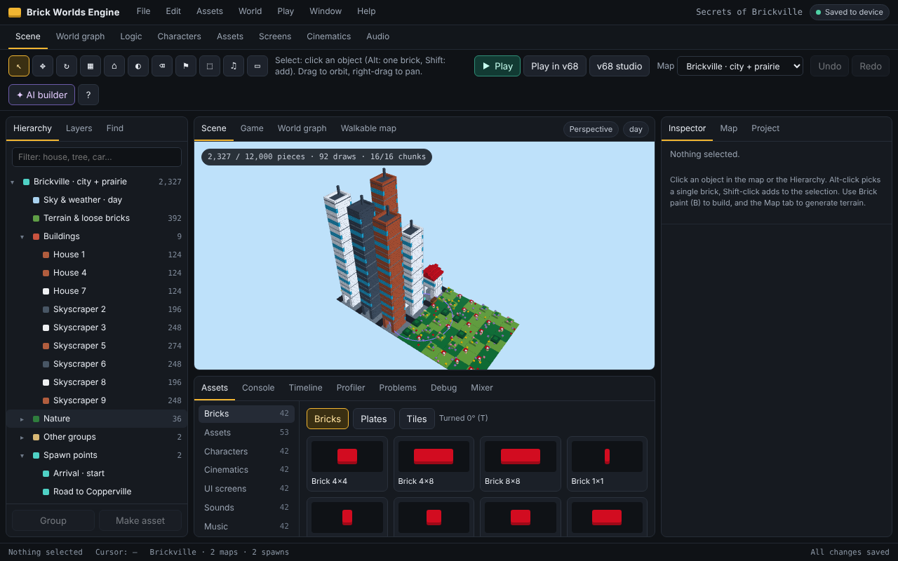

- **Top bar** — menus (File, Edit, Assets, World, Play, Window, Help), the project name and save status.
- **Workspace tabs** — Scene, World graph, Logic, Characters, Assets, Screens, Cinematics, Audio (keys 1–8).
- **Toolbar** — tools (Select V, Move W, Rotate E, Resize Q, Place asset B, Erase X, Spawn point P, Trigger zone Z, Sound emitter S, Sign U), **Play**, Undo/Redo, the map picker, the **✦ AI builder** and **?** for shortcuts. The hint next to the tools says what the current tool does.
- **Hierarchy** (left) — everything on the map by type: terrain, buildings, nature, spawn points, zones; Layers and Find are next to it.
- **Viewport** (middle) — drag to orbit, right-drag or Shift-drag to pan, wheel to zoom; Home fits the map, F frames the selection.
- **Dock** (bottom) — Assets (assets, characters, cinematics, screens, sounds, music), Console, Timeline, Profiler, Problems, Debug, Mixer.
- **Inspector** (right) — Inspector (what is selected), Map (terrain, sky, weather, music) and Project (name, start map, hero, first screen).

Everything you do is one undo step (Ctrl Z / Ctrl Shift Z) and is saved automatically.

## 5. Build a map

Click an object to select all of it (a house, a tree); Shift-click adds. The Inspector shows its position, turn and size, and Edit in the Assets screen opens the asset to change its bricks and colors.

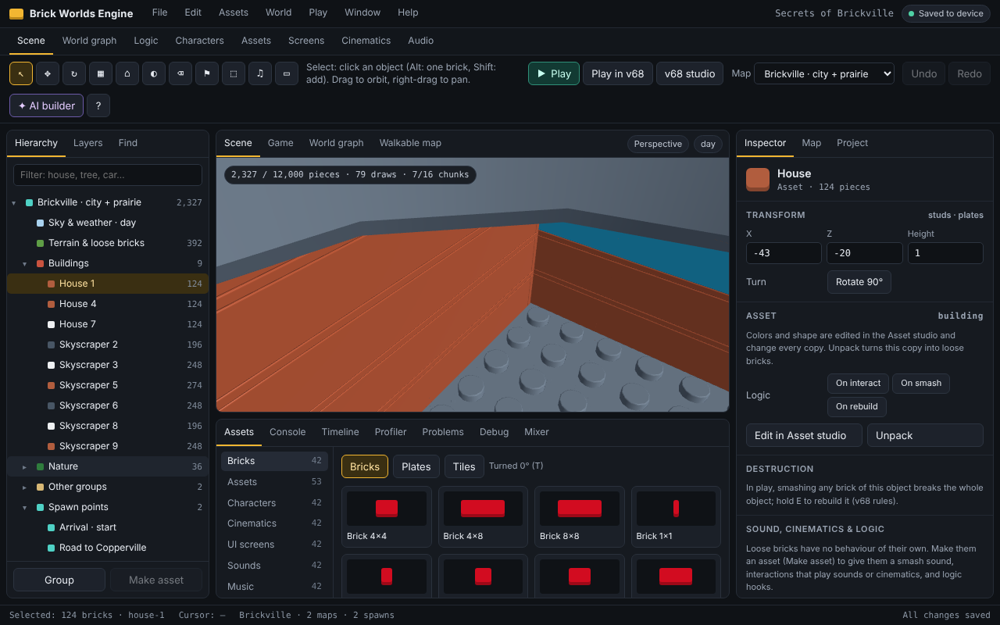

The **Map** tab holds the **terrain generator**: tick environments (forest, city, prairie, mountains, volcanoes, desert, beach, highway, castles, rainforest), pick a size and seed, and **Generate**. Houses, trees and cars become assets you can move, smash and edit. Time of day, weather and music are here too.

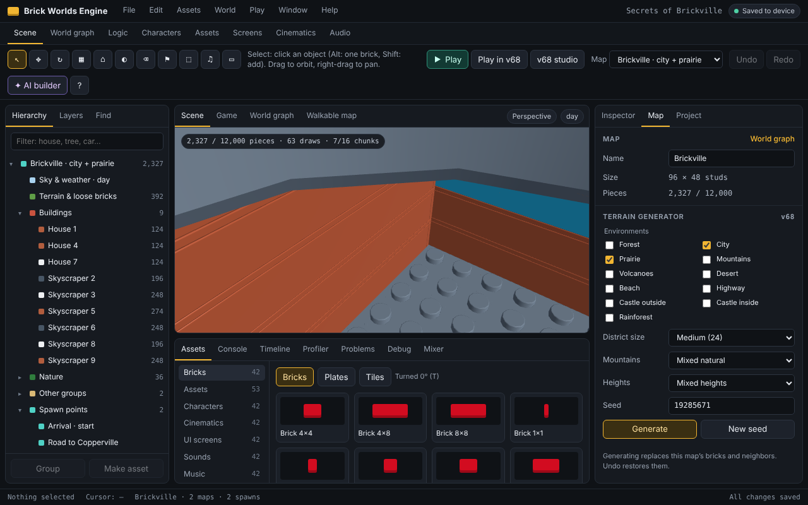

**Place (B)** puts down the asset you pick in the dock, and **T** turns it. Single bricks are built into assets in the **Assets** workspace: its library has an Assets tab (open an asset, or drag one onto the plate to build it in) and a Bricks tab (click or drag pieces onto the plate). Bricks sit on studs and never overlap, exactly like LEGO World v68. **Erase (X)** removes the object you click (things holding others up are protected).

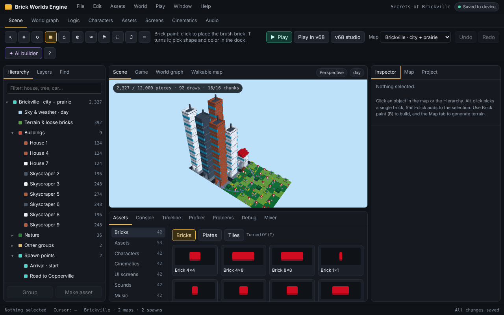

**Spawn point (P)** adds where the hero can start or arrive; **Trigger zone (Z)** draws a box that runs actions when the hero walks in or out (give an item, play a sound or cutscene, change the music).

## 6. Connect maps in the World graph

A game can have up to 16 maps. The World graph shows each map with its spawn points as ports: **+ Add map**, then drag from one spawn's dot to another's to connect them with a **gate**. Click a gate to make it one-way, reverse it, or play a cutscene on arrival. World › Validate routes checks that every map can be reached.

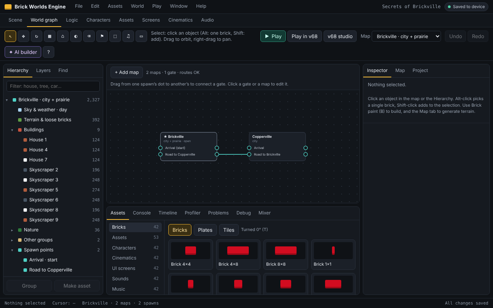

## 7. Assets

Assets are reusable objects made of bricks. Pick one in the dock and place it with **Place asset (A)**; every copy updates when the asset changes. The **Assets** workspace is a build plate for one asset: its bricks, **states** (closed/open), **sockets** (where the hero interacts), **interactions** (what E does: change state, give an item, play a sound or cutscene, send an event), smash and rebuild rules, and where the terrain generator scatters it.

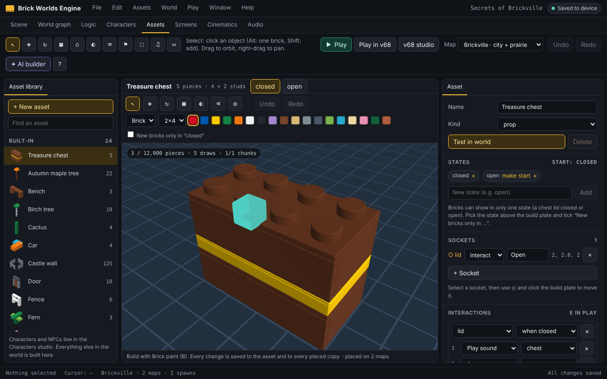

## 8. Characters

The **Characters** workspace dresses minifigures (hair, face, outfit, colors, gear) and animates them with keyframe **clips** on a timeline. Start from one of v68's presets; **Make player character** picks the hero. Every look choice opens a panel of pictures of your character wearing each option. In a clip's timeline, clicking a track rings its body part on the preview, the selected lane shows each key's value, and ⇆ Mirror copies a track to the other side of the body.

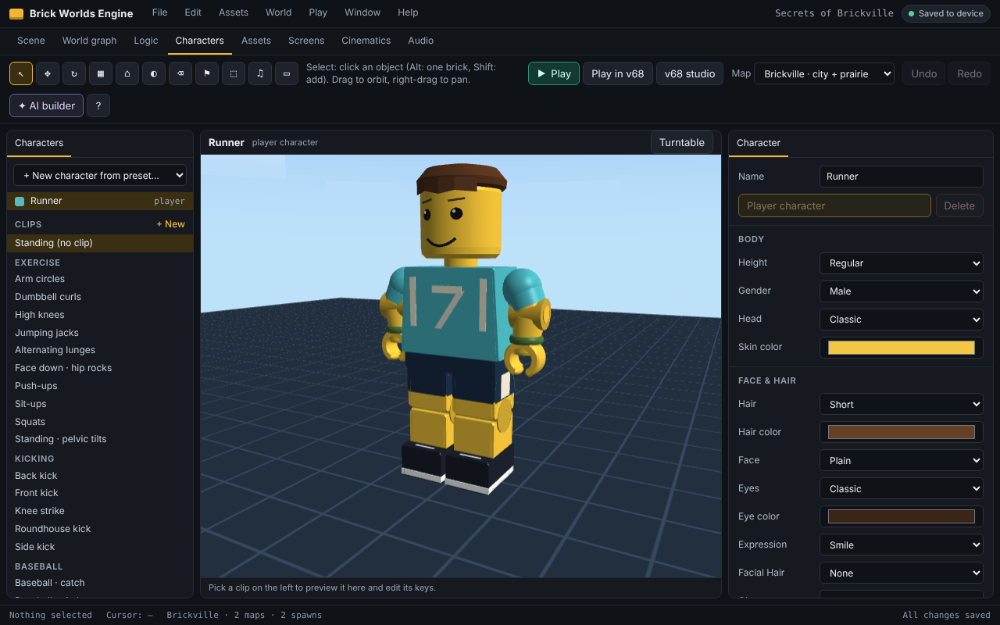

## 9. Logic: graph and code

Logic makes a map a game: *when* something happens (an event), *do* something (actions), maybe only *if* a condition holds. Add nodes from the palette on the left and drag from an output pin to an input pin to wire them.

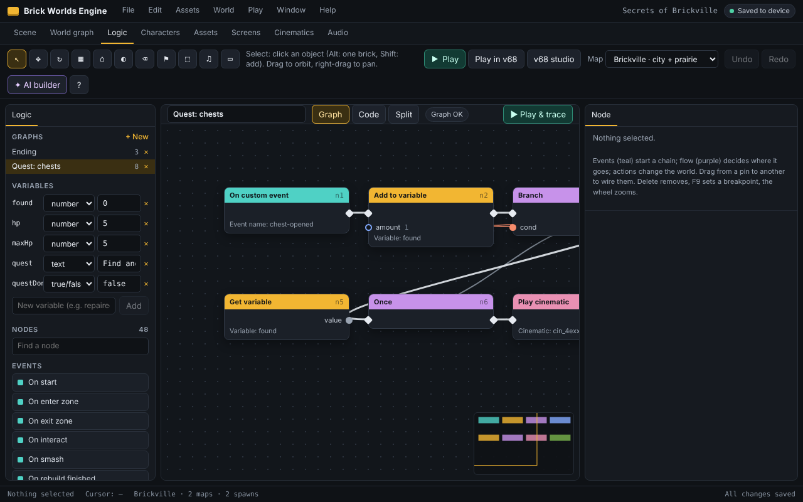

The same graph can be written as code. **Split** shows both side by side: edit either and the other follows. Click the gutter to set a breakpoint that pauses Play on that line.

```js
on("interact", { asset: "ast_…" }, (e) => {
  vars.coins += 1;
  if ((vars.coins >= 3)) {
    emit("won");
  }
});
```

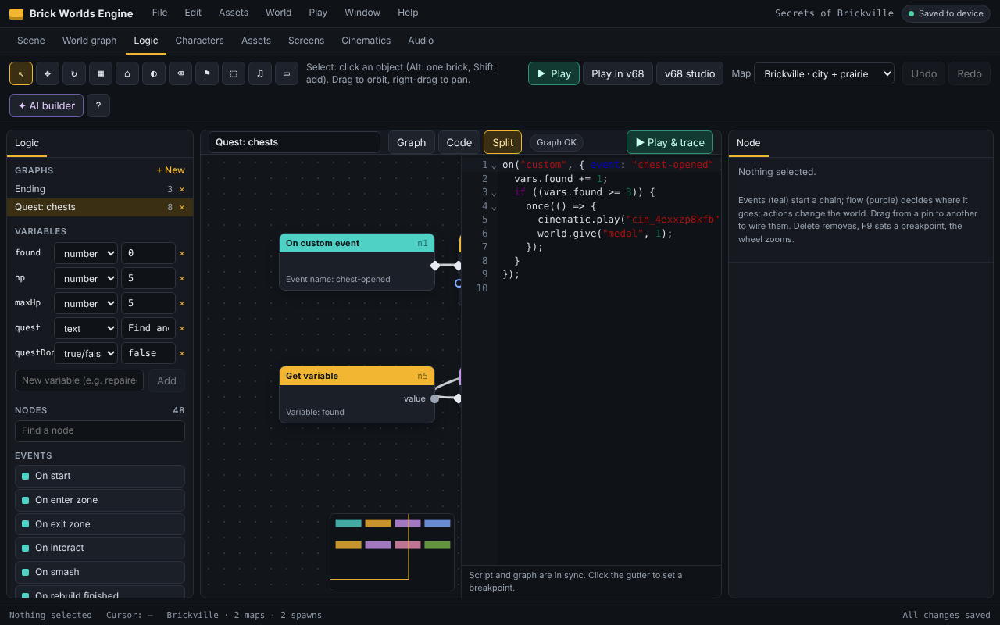

The coding course (section 3) teaches the whole language; Help › Coding guide and Help › Logic reference list every event and action.

## 10. Screens and HUD

Screens are the 2D layer: splash, title, HUD, pause, dialogue, game over and your own. Add widgets (text, buttons, images, hearts, bars, lists, minimap); write `{name}` in a text to show a live value such as `{coins}` or `{hp}`. Check the layout on phone and tablet frames.

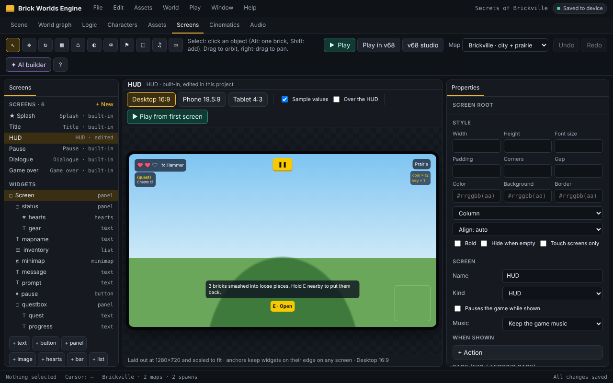

## 11. Cinematics

The **Director** stages cutscenes like a film shoot: cast actors, set marks and walk paths (Record ●), place cameras from the view, and add dialogue, music, sounds, fades and titles on the timeline. **New reward scene** makes a complete example. Zones, interactions, screen buttons, gates, clips or logic can start a scene.

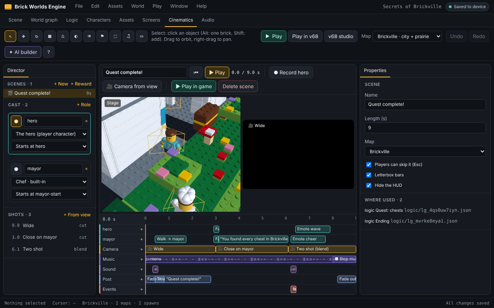

## 12. Audio

Games ask for named **sound events** (smash, jump, chest…) — each picks a clip, varies the pitch and limits how many play at once. **Music** states crossfade, the **mixer** sets bus volumes and ducks music under speech, each map has music and an ambience loop, and **Sound emitter (S)** places a looping or occasional sound in the world. Import your own .wav/.mp3/.ogg/.m4a files.

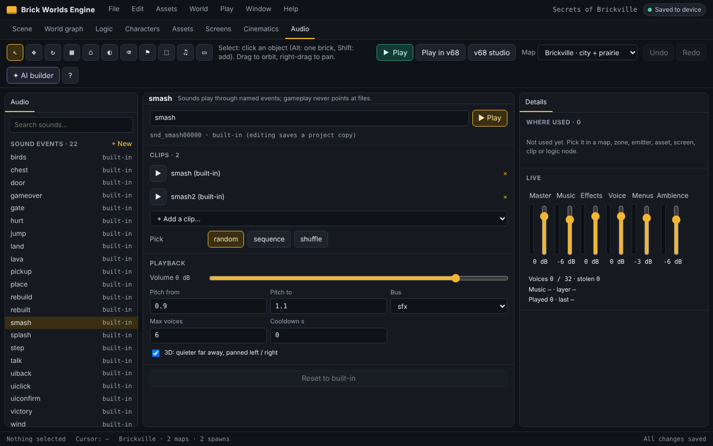

## 13. Play and debug

**Play (F5)** runs the game right in the editor; Shift F5 starts from the selected spawn, Ctrl F5 from the first screen. WASD or arrows move, Space jumps, F attacks (hold to charge), Q guards, C rolls, Z locks on, E uses and (held) rebuilds, T talks, 1–4 play emotes, Esc pauses. Nothing that happens while playing changes your project.

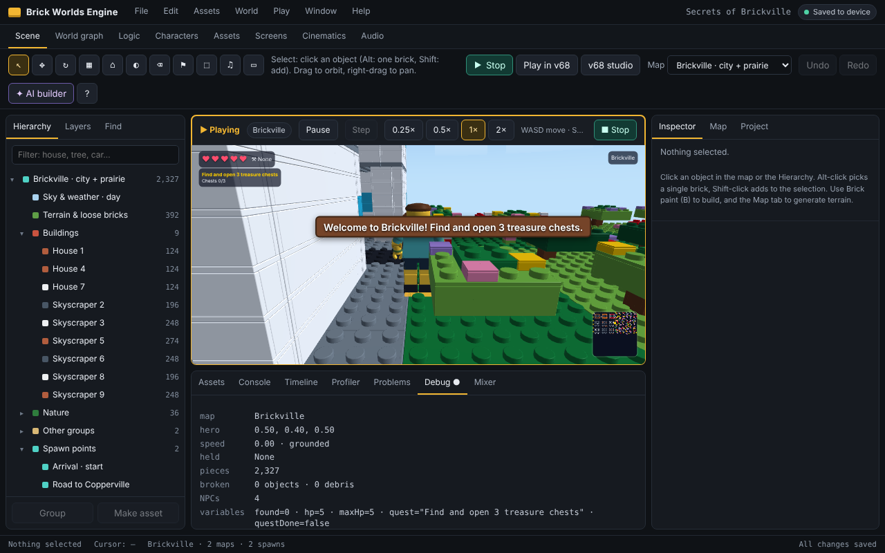

The play bar pauses, steps one frame and changes speed; the dock's **Debug** tab shows position, variables, items and screens live, plus cheats.

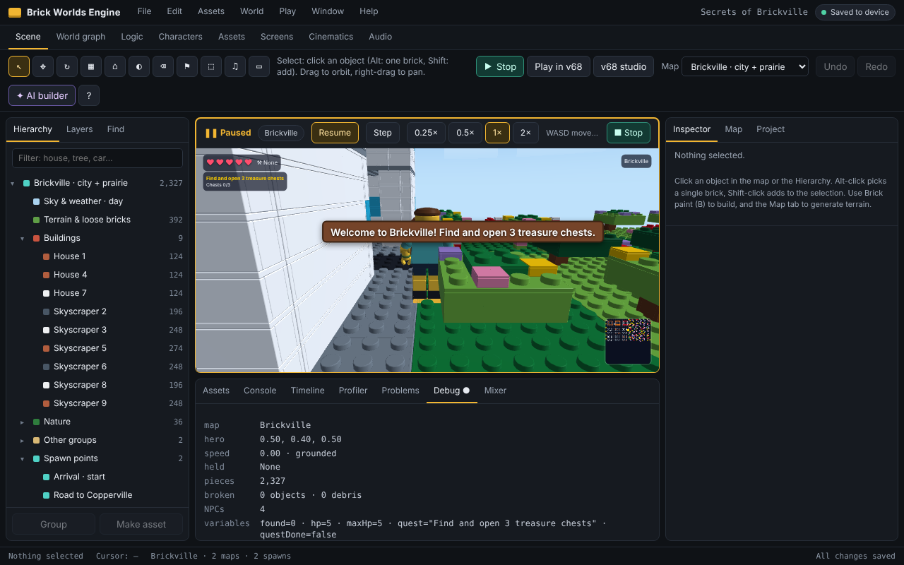

**Stop (F5)** returns to the editor exactly as it was. *Play in v68* runs the project in the original LEGO World v68.

## 14. The AI builder

Click **✦ AI builder** (Ctrl I) and describe a change in plain words. The AI may only use the engine's own commands — the same ones the editor runs when you click — so it never changes the engine itself, writes files directly, or reaches the internet. Choose a **scope** to limit what it may touch.

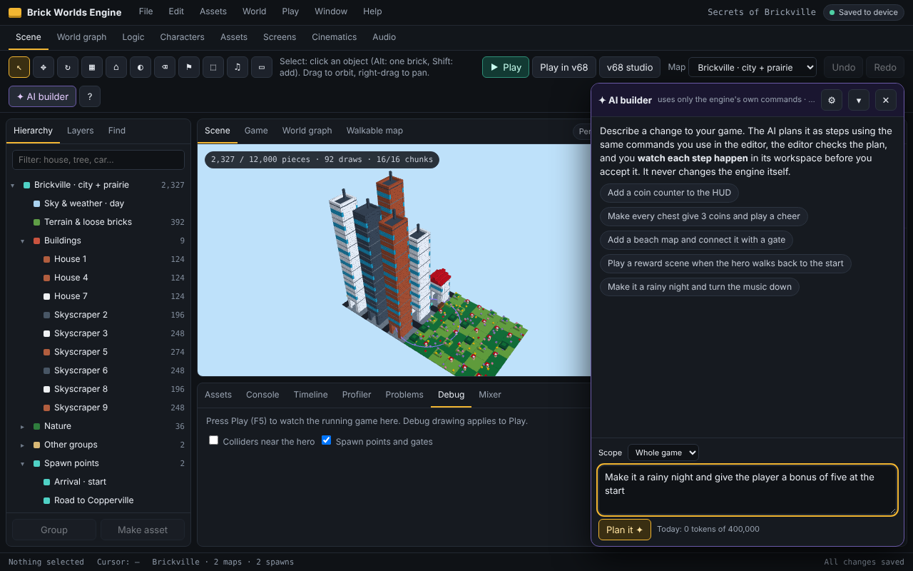

It reads your project, plans the change as steps, and the editor test-runs the plan before you see it (refused plans go back to the AI with the reason). Each step says what it does and how you would do it yourself.

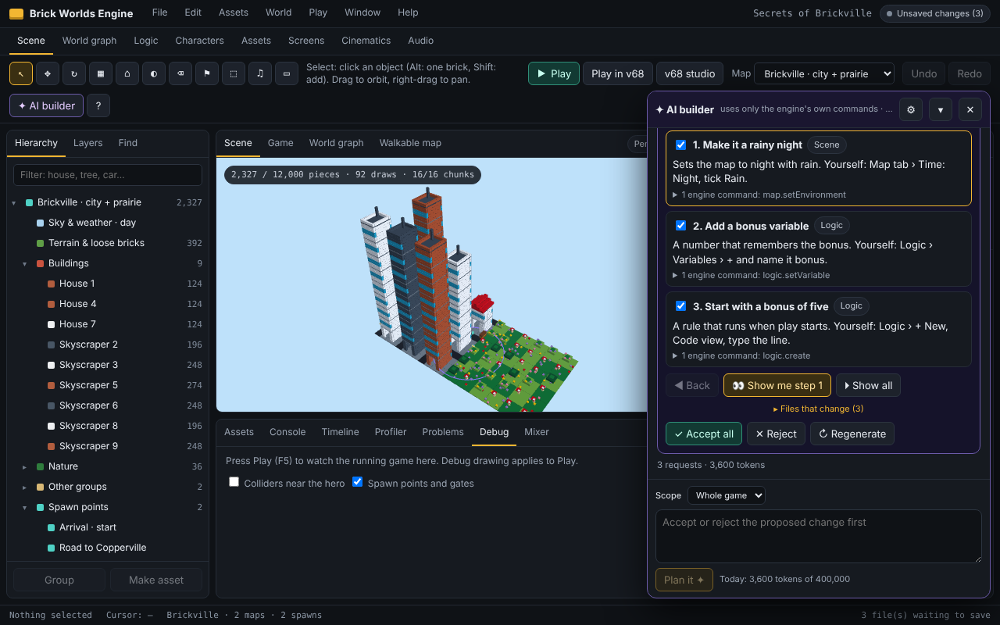

**Show me step N** applies that step live in its workspace — logic it writes opens in Split view so you see the code and the graph. **Back** takes it out again, **Files that change** lists every changed line. **Accept** keeps the steps you ticked as one undo step named “AI: …”; **Reject** leaves the project exactly as it was.

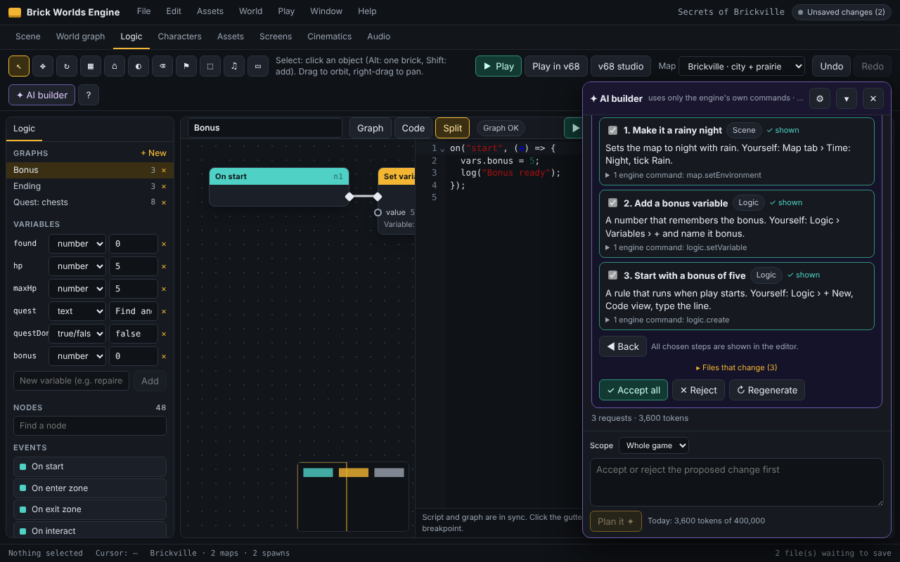

Who answers: inside a Claude artifact, Claude on your own Claude plan (no key; you are asked once to allow it). Elsewhere, add your own Anthropic API key in the panel's ⚙ settings — it stays in your browser, never in a project or export. Each request shows its token use, with a daily soft cap.

## 15. Shortcuts, command palette and phones

**Ctrl K** opens the command palette: type a few letters to find any command. **?** lists every shortcut (Help › Keyboard and touch has them all).

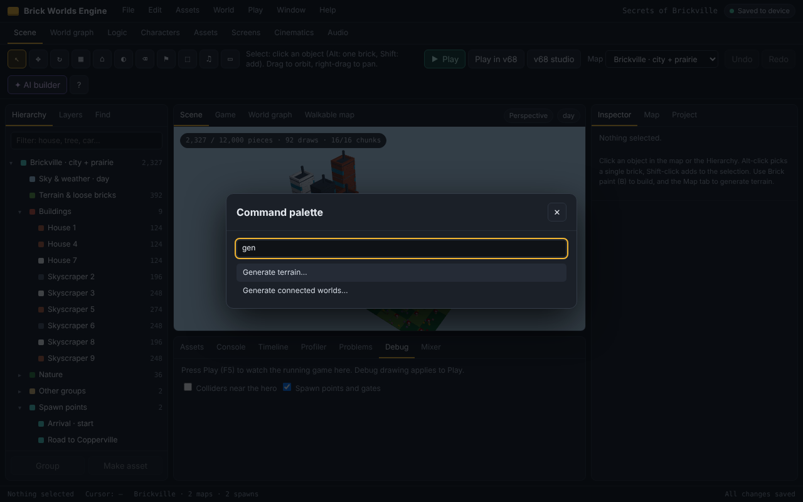

On a phone the editor switches to a compact layout with Outliner/Inspector tabs and touch controls for Play.

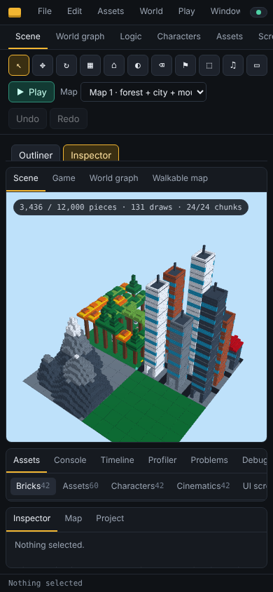

## 16. Saving and sharing

- Projects save themselves to your browser a moment after each change (the top bar says *Saved to device*); **Ctrl S** saves at once.
- **File › Open project** lists every project on this device; **File › Start hub** shows recent ones.
- **File › Save project file (Ctrl Shift S)** downloads a `.bwproj` (a zip of small JSON files plus any media) to keep, back up or send. **File › Import** opens one, or an old LEGO World save.
- **File › Export LEGO World save** writes a file the original v68 game can open.

Projects live in the browser you used: clearing site data removes them, so keep `.bwproj` copies of anything important.

## 17. If something goes wrong

- **A brick won't go there** — bricks need studs below (tiles have none) and can't overlap.
- **Play could not start** — the message names the problem; the dock's **Problems** tab lists issues with a jump button.
- **No sound** — click the game once (browsers start audio only after a click) and check the mixer.
- **The AI builder says Claude is not available** — allow it when the artifact asks, or add your API key in ⚙.
- **My code doesn't change the graph** — read the line under the code editor: it names the line and the problem.

More in Help › Troubleshooting. For developers: `npm run check` runs every check, `npm run test:e2e` the browser tests, and `docs/parity-checklist.md` records what each build phase added.

---

Screenshots are made by `node scripts/capture-engine-screenshots.mjs` (after `npm run build`), so they can be refreshed whenever the editor changes.
